# SproControl

An open, offline controller for the **iKape K2** portable espresso machine: an Android app with a
home-screen widget, the same UI as a browser page over Web Bluetooth, and a small Python library.
The machine's Bluetooth protocol was recovered by reverse-engineering the official app and then
verified byte-for-byte against the real machine; the full write-up is in [PROTOCOL.md](PROTOCOL.md).

<p align="center">
  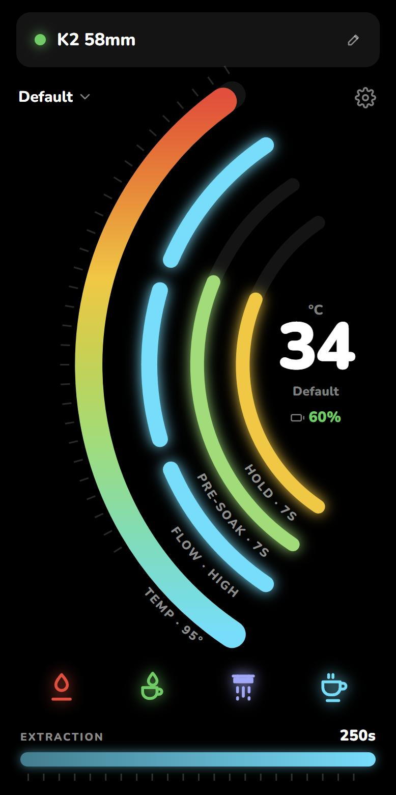
  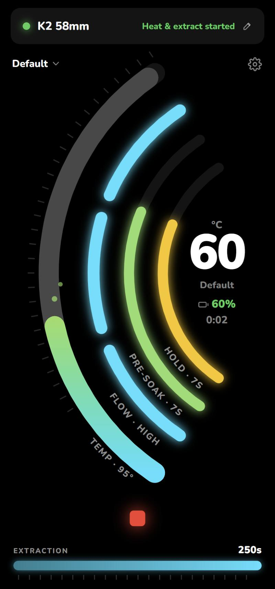
  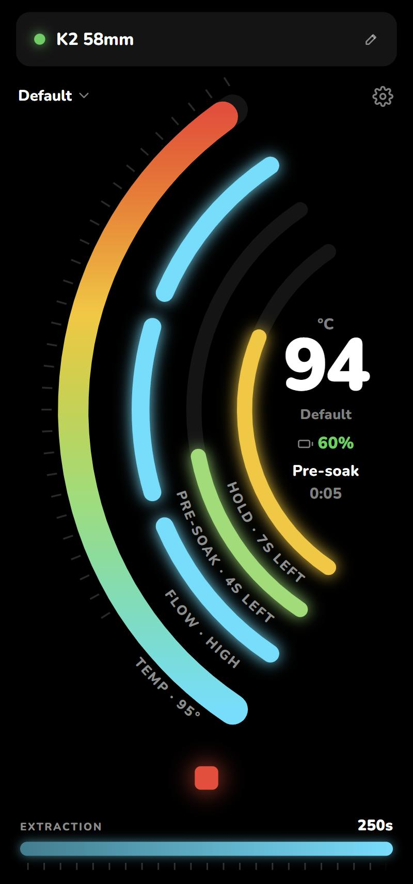
  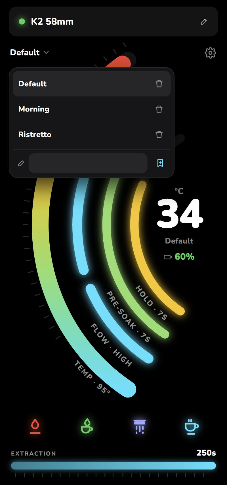
  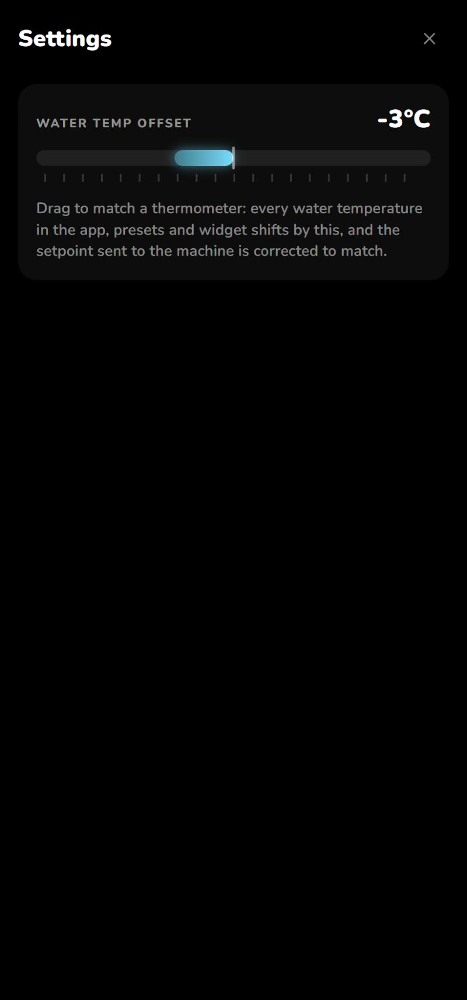
</p>
<p align="center">
  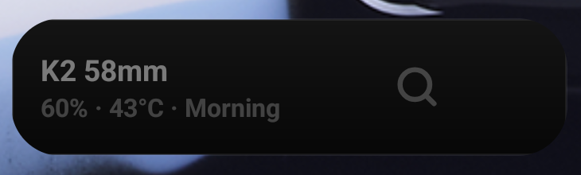
  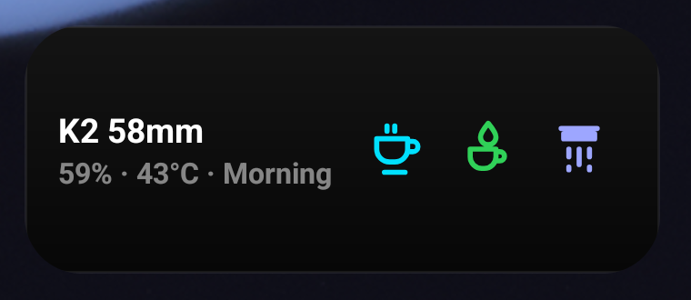
  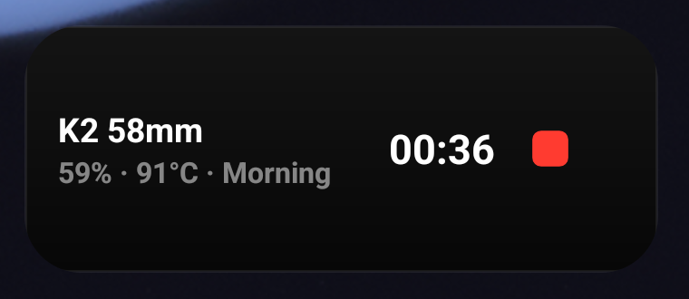
</p>
<p align="center">
  
  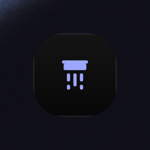
  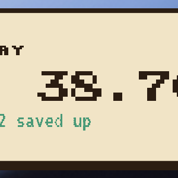
</p>

A 40 s mock brew (heating, pre-soak, hold, extraction, done) recorded on an emulator with the
machine's own frames replayed: [docs/brew-demo.mp4](docs/brew-demo.mp4).

> This project is not affiliated with the machine's maker. It drives a heater and a pump; use it at
> your own risk and keep the machine's own safety rules in mind.

## What it does

- **Four meters, one gauge.** Temperature, flow speed, pre-soak and hold are concentric arcs with
  their name and value curved along them; drag along an arc to set it. Extraction time is a straight
  bar underneath. Every change is sent once, on release, then read back from the machine and
  confirmed in the title bar (`Temp 92°C saved`), or retried if the machine dropped the write.
- **Heat, Heat & Extract, Extract, Purge.** Purge runs the pump alone with no pre-soak or hold, for
  the seconds (1–250; the K2 stores any value although it reports a 30 s minimum) and flow chosen in Settings (30 s and the brew's own flow by default); the temperature is
  never touched. The settings it replaced are kept on the phone and put back when it ends or is stopped,
  or, if it was interrupted, on the next connect or widget tap; if the machine already holds the purge
  settings nothing is swapped. Any running mode turns the row into one Stop button. Connecting never
  changes what the machine holds: the app adopts the machine's settings and names them if a preset
  matches.
- **Live readout.** Water temperature, battery and charging state from the machine's status frames
  (about one per second). While heating, the preset part of the arc turns grey and the colour climbs
  with the water temperature, with bubbles rising from it.
- **Brew timer and phases.** The pre-soak and hold arcs count down during a brew; the phase and an
  elapsed timer sit under the readout, and the final time stays for 10 s after the brew.
- **Presets.** Name and save the current settings; the last-used preset is re-applied on connect and
  its name sits under the temperature and in the widget. A **Default** preset with the machine's
  factory settings (95 °C, pre-soak 7 s, hold 7 s) is there from the first run. Presets, the device
  nickname and the offset live only on the phone.
- **Water temperature offset.** Calibrate against a thermometer: every temperature shown is
  shifted, and the setpoint sent to the machine is corrected the other way.
- **Presets you did not save are kept too.** Brewing with settings that match no preset keeps them as the
  last-used profile under the name `7 • 7 • 95°C` (pre-soak • hold • temperature), so the widgets show
  and brew with exactly what you last used.
- **Two home-screen widgets.** The row widget: dimmed with a Search button until it has reached the
  machine, then Extract / Heat & Extract / Purge, and a running timer with Stop while brewing. The
  one-cell widget: a square with a single button that steps through a cycle you compose in Settings from
  Purge, Heat & Brew, Extract, Heat and Stop (default purge → stop → brew → stop → purge → stop); its only text is
  the brew state a brew step will send. Both widgets show a small red dot at their top right, and the
  app's battery readout flashes red, from the charge set in Settings (30 % by default) down. A widget tap always wins: if the app holds the link, the app drops it
  and closes, and the tap runs on the widget's own link. Connect shows until a status frame has arrived and Stop takes over
  while the machine runs; whenever the link is lost the widgets go back to Search / Connect and the cycle restarts. Each tap is
  one Bluetooth session: connect, send, wait for the machine's state to confirm the command (a spinner
  meanwhile; the cycle only moves on once it has). The link then stays open for a minute after the last tap,
  held by a small foreground service, so the next tap sends within about 10 ms instead of reconnecting; a tap
  on a cold link sends about 1 s after the touch. The widgets never scan, so they never need location; while
  the app itself holds the link, the app lets go and closes so the tap can run. A quiet minute drops the
  link and the service, and nothing polls in the background.
- **No brew on unconfirmed settings.** In the app a brew starts only once the machine has read back all
  five settings it was sent (temperature, flow, pre-soak, hold, extraction); a rejected or unanswered
  set, or a machine error, greys the brew buttons.
- **The widgets keep two states and nothing else.** The *brew state* is the five values the app last set
  on the machine and saw read back; only the app changes it (choose a preset, or drag a meter), and the
  one-cell button shows it as `pre-soak • hold • temperature`. The *purge state* is the flow and seconds
  from Settings with no pre-soak or hold. A widget purge sends the purge state and starts; a widget brew
  sends the brew state, waits for the machine to read all five values back, and only then starts, so a
  purge can never leave a brew on the wrong settings. A widget command has half a second to be
  acknowledged; after that nothing more is sent and the button stays put.
- **Offline by design.** The app never touches the network on its own. The link is held while the
  app is on screen and for 30 s after you leave it, then dropped and the page is paused. Before
  connecting, the whole UI is shown greyed out with the values the machine last reported.
- **Updates on request.** Settings has a check button: one HTTPS request to this repository's GitHub
  Releases, and, if you accept, the APK download. The download is checked against the SHA-256 in the
  release notes and against the installed app's signing certificate before Android's installer is
  asked to install it. Nothing is checked automatically.
- **Browser version.** `k2.html` is the same UI; opened in Chrome it talks to the machine through
  Web Bluetooth (phone or laptop), no install needed.

## Architecture

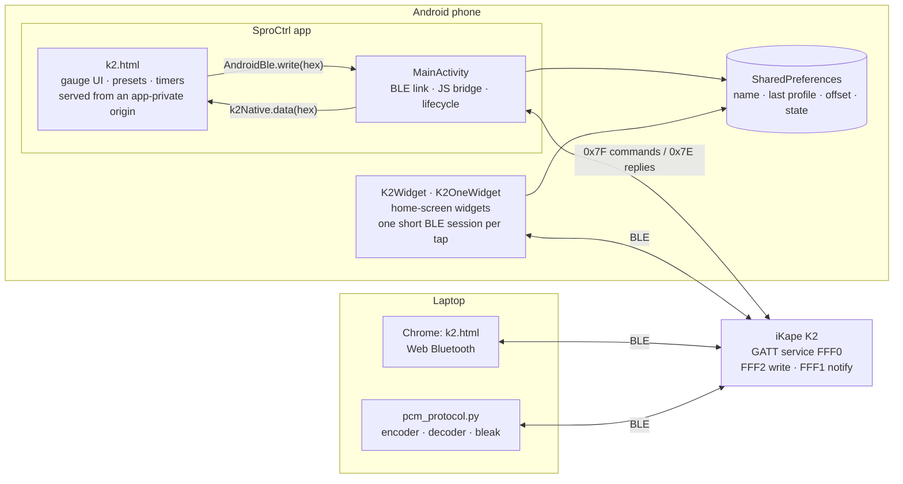

The page is one HTML file with no dependencies. On Android it runs in a WebView that serves it (and
its bundled font) from assets under a private `https://app.sprocontrol.local/` origin; every other
request is denied. The page never sees Bluetooth directly: it hands complete frames to Java as hex
and gets notification bytes back the same way, so the protocol code is identical in the APK and in
the browser.

## How a session runs

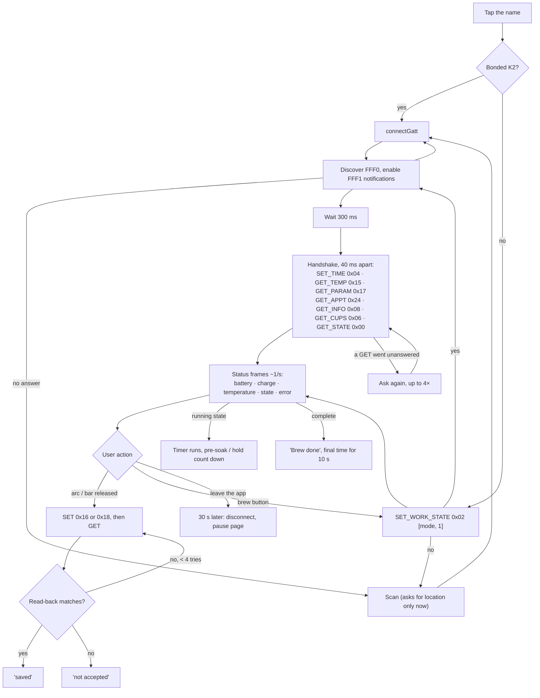

## The protocol in one table

Frames are `7F LEN_HI LEN_LO CHK CMD DATA…` from the phone and `7E …` from the machine, with
`LEN` the whole frame length and `CHK` the byte sum of everything else. Details, reply layouts and
worked examples: [PROTOCOL.md](PROTOCOL.md).

| Opcode | Meaning | Data |
|---|---|---|
| `0x00` | state | reply: battery, charge flags, temperature °C, state, error |
| `0x02` | start / stop | `[mode 0 heat · 1 heat+extract · 2 extract, 1/0]` |
| `0x04` | clock | `[weekday, month, day, year−2020, h, m, s]` |
| `0x15` / `0x16` | preset temperature | **°F** on the K2 (`100..204` = 38..96 °C) |
| `0x17` / `0x18` | brew parameters | `[flow, pre-soak, hold, extraction]` with ranges in the reply |
| `0x06` `0x08` `0x24` | cups, device info, schedule | query |

There is no authentication on the link. That is the machine's design, not something an app can
add: anyone in range who knows these frames can control it. Bonding gives link encryption only.

## How the protocol was recovered

1. **The official app.** HappyGo (`com.timeyaa.flutter_coffeecup2`, Flutter). Java decompilers only
   show the Flutter embedding; the logic is AOT-compiled Dart in `libapp.so`. `strings` on that
   library gave class names (`PcmBlePack`, `BleFrameDecoder`, `PcmDevice`), enum names and the
   `0000xxxx-0000-1000-8000-00805F9B34FB` UUID base, but no opcodes: integer literals are compiled
   into the AOT snapshot, not the string pool.
2. **Sniffing, and why it failed.** The phone (OPPO, Android 14, not rooted) exposes no HCI snoop
   log: `bluetooth_hci_log` is unset, `/data/misc/bluetooth/logs` is unreadable, `adb bugreport`
   ships without a btsnoop on this ROM, and Wireshark's `androiddump` was not installed. The one
   thing available, the btsnooz summary inside `dumpsys bluetooth_manager`, was decoded with a small
   custom parser (version byte, 64-bit timestamp, zlib body, per-record lengths and deltas): it held
   only two ATT operations and no payloads. The machine's USB port is charge-only.
3. **GATT by hand.** nRF Connect, driven over `adb` (`input tap`, `screencap`) so the steps were
   repeatable, found service `FFF0` with `FFF1` (notify) and `FFF2` (write without response), the
   bonded name `Hi-t-1292G0_B526` and the fact that the machine pushes an 11-byte status frame on its
   own once notifications are on. Comparing frames across states gave the checksum rule. The official
   app's aggressive auto-reconnect kept stealing the link, so it was disabled with
   `pm disable-user` for the duration.
4. **Reading the Dart.** [blutter](https://github.com/worawit/blutter), built in a throwaway
   `ubuntu:24.04` container because there was no native toolchain on the laptop, turned `libapp.so`
   into annotated ARM64 assembly plus an object pool. From there: the frame builder and checksum
   (`PcmBlePack.sendData`/`check`), every opcode (from the `BleCommand` objects in the pool; list
   constants are Smi-tagged, i.e. value × 2), the
   connect sequence with its 300 ms and 40 ms delays (stored as microseconds), the enum tables for
   states and errors, and the fact that the only AES in the app decrypts firmware downloads, not
   Bluetooth traffic. That became `PROTOCOL.md` and `pcm_protocol.py`, whose self-check caught that
   the first hand-computed checksums were wrong, not the code.
5. **Guess and check against the machine.** Each guessed field was settled by changing one thing at
   a time and watching the bytes: a setting moved in the official app while its logcat frames were
   compared, then candidate frames written to the machine from the laptop (`pcm_protocol.py` over
   bleak) and read back until the spec held byte for byte. That is how the temperature setpoint
   turned out to be °F, and how the purge length turned out to accept any value from 0 to 255 even
   though the machine reports a 30–250 s range.
6. **Validation with a Bluetooth logger.** Two loggers, both `adb logcat`:
   - HappyGo logs its own traffic (`send data:` / `Receiving data:`), which showed the predicted
     handshake frames byte-for-byte and in the predicted order.
   - This app logs every frame it sends and receives under the `K2` tag. Those logs, captured during
     real sessions, exposed everything the binary could not: the preset temperature is kept in **°F**
     (the first setpoints sent in °C were silently ignored as below the 100 °F minimum), the machine
     stores whole °C and reads back `floor(°C × 1.8 + 32)`, long replies arrive in fragments with their
     own headers, and writes sent in quick succession are sometimes dropped without an echo. The
     app's read-back check with resend exists because of that log.
7. **Android got in the way.** The OPPO ROM drops scan results for apps that declare Bluetooth
   scanning as "never for location", so the app connects to the bonded device directly and only asks
   for location when it has to scan. The WebView has no Web Bluetooth, hence the Java bridge. A page
   loaded from `file://` cannot load its own font (cross-origin), hence the private origin. `aapt2`
   on Windows writes asset paths with backslashes, hence assets are added with `jar`.

### Challenges and how they were solved

| Challenge | Resolution |
|---|---|
| Flutter app: no Java to decompile | `strings` for names, blutter for the Dart AOT code |
| No HCI snoop on an unrooted OPPO | Decoded the `dumpsys` btsnooz buffer (no payloads), then nRF Connect driven over adb |
| HappyGo stole the Bluetooth link | `pm disable-user` while capturing, re-enabled after |
| Opcodes invisible in strings | Smi-tagged constants in the assembly, enum names from the object pool |
| Setpoints ignored by the machine | Logged traffic showed °F; convert and compare read-backs in °C |
| Writes occasionally dropped | Read back every set and resend up to three times |
| "Not found" on the first scan | ColorOS location deny list; bonded-device shortcut, just-in-time location |
| Location prompt on every connect (unbonded phone) | The machine's address is remembered after the first link; later connects, app and widgets, go to it directly without a scan |
| Widget could not reach an unbonded K2 by address | The K2 may advertise a random address, which a plain address lookup cannot connect to: the address type is kept with the address (the app never pairs with the machine) |
| Widget waited for a status frame that never came | The K2 only starts its once-a-second status push after it has been given the clock (HappyGo's first command): the widget now sends the clock 300 ms after notify-on, then asks for the state each second; the first status frame arrives about 3 s after connecting |
| Widget writes silently lost | The phone's stack answers 201 (busy) to a write queued right behind another; the widget checks the result and resends after 60 ms |
| Widget commands ignored right after connecting | The K2 drops writes for about 400 ms after notifications are enabled (HappyGo waits 300 ms): the first command waits 350 ms, and a read-back that differs or never comes resends the settings, twice at most |
| Each tap took 4–5 s | Every tap opened a fresh link and waited for the K2's status push, which only starts a few seconds after the clock is sent. Now the link is held for a sliding minute (a foreground service keeps the process alive) and a cold tap acts on the last saved state when it is under two minutes old |
| Widget taps fought the app for the single link | App publishes a short "hold" flag the widget respects |
| App kept the link alive in the background | 30 s grace after leaving, then disconnect and pause the page |
| Bundled font not loading in the APK | Private `https://` origin via `shouldInterceptRequest`; assets packaged with `jar` |

## Security notes

The code was reviewed on the assumption that nothing is trusted: not the machine, not stored data,
not the page.

- The WebView answers requests from assets or denies them; the only network use is the update check
  the user starts, limited to `https` on GitHub hosts (redirects included), with a size cap, a
  checksum check and a signing-certificate check before the installer runs.
- Everything that crosses a boundary is validated: frames (length, checksum, ranges), bridge
  arguments (hex, lengths, JSON fields), stored presets and remembered values.
- Device names reach the page JSON-quoted, never as code; preset names are rendered as text.
- Release builds are not debuggable and are signed with a dedicated key; backups are disabled.
- The widget's receiver is not exported and its intents are explicit and immutable.
- No background work: no polling, no services, one inexact alarm to clear the final brew time.

## Build and install

Requirements: Android SDK build-tools 35, platform 35, a JDK (Android Studio's works) and `adb`.
No Gradle.

```powershell
powershell -File android/build.ps1            # release: not debuggable, release key
powershell -File android/build.ps1 -Debug     # debuggable, debug key
powershell -File android/build.ps1 -Install   # ...and push to the connected phone
```

The first release build creates `~/.android/sprocontrol-release.jks` and its password file next to
it; back both up, updates must be signed with the same key. Pair the machine once (in the app, or
with any BLE tool), then tap the name to connect.

### Publishing a release

Tag the commit (`v1.0.0`), attach `android/out/k2.apk` (renamed, e.g. `SproControl-1.0.0.apk`) and
put the `sha256 …` line that `build.ps1` prints into the release notes; the app's update check reads
the tag, the `.apk` asset and that checksum.

### Browser

Serve the repository (`python -m http.server 8765`) and open `k2.html` in Chrome; on a phone, forward
the port with `adb reverse tcp:8765 tcp:8765`.

### Tests

- `python pcm_protocol.py` runs the encoder/decoder self-check, including frames captured from the
  machine.
- `tests/page_test.html` runs the page's protocol layer in a browser against captured frames: decoding,
  checksum rejection, bridge validation, °F conversion, read-back and resend, purge, timers.

## Layout

| Path | What |
|---|---|
| `k2.html` | The whole UI (also the browser version) |
| `android/` | Manifest, `MainActivity`, `K2Widget` (row widget), `K2OneWidget` (one-button widget), `ApkProvider` (update installs), resources, `build.ps1` |
| `fonts/` | Nunito (SIL OFL 1.1) |
| `pcm_protocol.py` | Frame encoder, reply decoder, `bleak` sender |
| `PROTOCOL.md` | The recovered protocol, with live verification notes |
| `tests/` | Browser self-check for the page |
| `docs/` | Screenshots and the demo clip |

## Not covered

Cup history, device-info and schedule replies are not decoded; the flow-speed setting is stored by
the machine but its effect on the pump was not confirmed; the K2 is the only model tested.

## License

MIT, see [LICENSE](LICENSE). Nunito is licensed under the SIL Open Font License 1.1.
